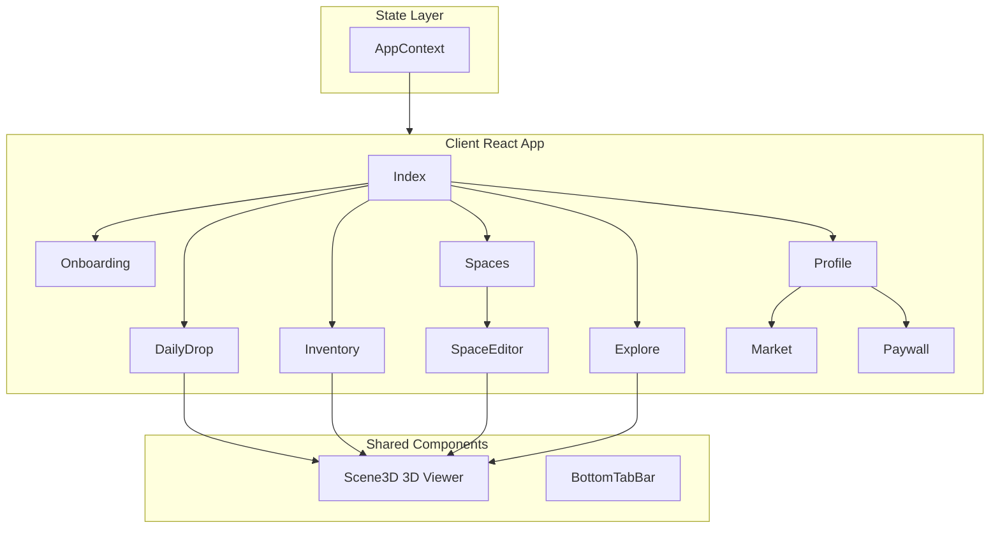

<!-- 9a37803c-80c8-4857-9d02-3004bfd95455 -->
# План разработки NeoVerse

## Текущее состояние проекта

**Стек:** React 18, TypeScript, Vite, React Three Fiber + Drei, shadcn/ui, Tailwind CSS, Framer Motion, TanStack Query.

**Реализовано:**
- Онбординг (3 шага: приветствие, никнейм+аватар, создание 2 пространств)
- Daily Drop (анимация раскрытия капсулы, карточка объекта, Claim)
- Inventory (сетка карточек с 3D-превью)
- Spaces (список карточек-превью)
- Explore (лента публичных пространств, лидерборд с вкладками Daily/Weekly/All-time)
- Profile (карточка пользователя, статистика, кнопки Market/Achievements)
- Компоненты: `Scene3D` (R3F, геометрии, материалы), `BottomTabBar`, стили glassmorphism/rarity

**Отсутствует для MVP:**
- Space Editor (3D-редактор сборки)
- Play 7s (симуляция динамических объектов)
- Публикация пространства (обложка, теги)
- Market (листинги, покупка/продажа)
- Paywall (Free/Pro/Pro+)
- Доработки: выбор пространства в Add to Space, фильтры в Inventory/Spaces, полноэкранный 3D-просмотр

---

## Архитектура приложения

---

## Этапы разработки

### Этап 1: Доработка существующих экранов

**1.1 Daily Drop**
- Добавить диалог выбора пространства для кнопки "Add to Space" (список пространств пользователя)
- Реализовать логику добавления объекта в выбранное пространство через AppContext
- Улучшить анимацию раскрытия: частицы/вспышка (через drei `Points` или CSS)

**1.2 Inventory**
- Добавить фильтры: редкость, сет, тип (static/dynamic), эффект (если есть в типах)
- Детальный просмотр по тапу: модальное окно / drawer с полноэкранным Scene3D, Inspect (вращение)
- Использовать существующий `Select`/`Tabs` для фильтров

**1.3 Spaces**
- Фильтр Public/Private (toggle или Tabs)
- Ограничение Free: показывать только 2 пространства (1 public + 1 private)
- Кнопка "+" для нового пространства → вести на Paywall для Free
- Клик по карточке → переход в Space Editor

**1.4 AppContext**
- Добавить: `addObjectToSpace(spaceId, object)`, `createSpace(name, visibility)`, `updateSpace(spaceId, data)`
- Хранить `subscriptionPlan: 'free' | 'pro' | 'pro+'` в UserProfile

---

### Этап 2: Space Editor (ключевой модуль)

**2.1 Структура экрана**
- Файл: `src/pages/SpaceEditor.tsx`
- Маршрут: `/space/:id` (добавить в `App.tsx` / `Index.tsx`)
- Layout: 3D-сцена (70–80%), нижняя панель (inventory tray), боковая панель (по кнопке) — Sheet

**2.2 3D-сцена (React Three Fiber)**
- Отображать объекты из `Space.objects` (SpaceObject[]) с трансформами
- Использовать/расширить `Scene3D` или создать `EditorScene` с поддержкой:
  - Рендер нескольких мешей по `objects`
  - OrbitControls (drei) для камеры (1 палец — вращение, 2 — zoom)
  - Выбор объекта: raycasting (useFrame + raycaster)
  - Drag объекта: `@react-three/drei` `DragControls` или кастомный drag по плоскости

**2.3 Gizmo и трансформы**
- Перемещение (move), вращение (rotate), масштаб (scale) — кольца/ползунки вокруг выбранного объекта
- Вариант: использовать `transform-controls` из drei (`TransformControls` с mode translate/rotate/scale)
- Состояние: `selectedObjectId`, обновление `position/rotation/scale` в Space.objects

**2.4 Нижняя панель (Inventory Tray)**
- Горизонтальный ScrollArea с объектами из `inventory`
- Drag-and-drop в сцену: при drop создавать `SpaceObject` с дефолтными трансформами и добавлять в `Space.objects`
- Или tap для "добавить в центр сцены"

**2.5 Боковая панель**
- Настройки: освещение (пресеты), фон (gradient/color), snap grid (on/off), физика (вкл/выкл для Play 7s)
- Кнопки: Undo, Redo, Duplicate, Delete (для выбранного объекта)

**2.6 Undo/Redo**
- Хранить стек состояний `Space.objects` (или полного Space)
- `useReducer` или кастомный хук с `history: SpaceObject[][]`, `historyIndex`

**2.7 Snap to Grid**
- При перемещении округлять position к шагу сетки (например, 0.5)

---

### Этап 3: Play 7s и публикация

**3.1 Play 7s**
- Кнопка "Play 7s" в Space Editor
- Режим симуляции: динамические объекты получают импульс (направление, сила) — упрощённо: анимация вращения/дрейфа
- Таймер 7 секунд сверху (Progress или текст)
- После окончания: кнопки "Save Take", "Replay", "Back to Edit"
- MVP: без записи видео — только симуляция + стоп-кадр как превью (опционально сохранить "лучший кадр" как cover)

**3.2 Публикация**
- Кнопка "Publish" в Editor
- Диалог: выбор обложки (генерация thumbnail из текущего ракурса камеры — `gl.domElement.toDataURL` или `html2canvas`), теги (input/chips), переключатель public
- Предупреждение о правилах контента
- Обновление Space: `visibility: 'public'`, `coverImageUrl` (base64 или placeholder)

---

### Этап 4: Explore и Leaderboards

**4.1 Explore**
- Полноэкранный 3D-просмотр пространства по тапу на карточку (модальное окно / отдельный экран)
- Компонент `SpaceViewer`: рендер Space.objects в 3D, OrbitControls
- Кнопки реакций (⭐🔥💎) с обновлением счётчика (mock)
- Бейдж "Magic Finger" (Pro+) — пока заглушка

**4.2 Leaderboards**
- Раздельные данные для Daily/Weekly/All-time (расширить mockData)
- Тематические лидерборды (опционально): отдельная вкладка "Mirror Week" с фильтром

---

### Этап 5: Market

**5.1 Страница Market**
- Маршрут: `/market` или вкладка в Profile/Explore
- Разделы: Objects, Spaces (Tabs)
- Карточки листинга: превью (3D thumbnail или градиент), редкость, цена, кнопки "Buy now", "Make bid" (для аукциона — mock)

**5.2 Детали листинга**
- Модальное окно с 3D-превью, описанием, ценой, кнопкой покупки

---

### Этап 6: Paywall

**6.1 Компонент Paywall**
- Три карточки: Free (текущий план), Pro, Pro+
- Сравнительная таблица фич (строки: объекты/день, пространства, Magic Finger и т.д.)
- Стиль: glassmorphism, gradient border для Pro+
- Кнопки "Current" / "Upgrade" (mock — без реальных платежей)

**6.2 Интеграция**
- При клике "+" в Spaces для Free → открывать Paywall
- В Profile — кнопка "Upgrade" если Free

---

### Этап 7: Техническая база и polish

**7.1 Роутинг**
- Добавить React Router маршруты для SpaceEditor (`/space/:id`), Market (`/market`)
- Навигация назад из Editor/Market в основной tab-интерфейс

**7.2 Persistence (опционально для MVP)**
- localStorage для user, inventory, spaces, currentDrop — восстановление при перезагрузке
- Или оставить in-memory до появления бэкенда

**7.3 Расширение типов**
- `Object3D`: добавить `effect?: string` по спецификации
- `Space`: `coverImageUrl?: string`, `tags?: string[]`, `publishedAt?: string`

---

## Приоритизация (MVP first)

| Приоритет | Задача | Сложность |
|-----------|--------|-----------|
| 1 | Add to Space — выбор пространства, добавление объекта | Низкая |
| 2 | Inventory: фильтры, детальный просмотр (Inspect) | Низкая |
| 3 | Spaces: фильтр Public/Private, переход в Editor | Низкая |
| 4 | Space Editor: базовая сцена, добавление объектов, TransformControls | Высокая |
| 5 | Space Editor: Undo/Redo, Snap, боковая панель | Средняя |
| 6 | Play 7s (упрощённая симуляция) | Средняя |
| 7 | Публикация (обложка, теги) | Средняя |
| 8 | Explore: полноэкранный 3D-просмотр | Средняя |
| 9 | Paywall | Низкая |
| 10 | Market (базовый UI) | Средняя |

---

## Ключевые файлы для изменения

- `src/context/AppContext.tsx` — новые методы, subscriptionPlan
- `src/pages/Index.tsx` — роутинг для Editor/Market
- `src/App.tsx` — маршруты
- `src/types/index.ts` — расширение типов
- `src/data/mockData.ts` — доп. данные
- **Новые:** `src/pages/SpaceEditor.tsx`, `src/pages/Market.tsx`, `src/components/paywall/Paywall.tsx`, `src/components/space/SpaceViewer.tsx`

---

## Открытые вопросы (из README)

1. **Платформа:** Web (текущий выбор) — mobile-first layout уже есть
2. **Пользовательские импорты:** Не в MVP
3. **Комментарии:** Только реакции в MVP
4. **Экономика:** Mock для MVP, реальные платежи — позже
5. **Magic Finger (Pro+):** Режим "игры" с чужими пространствами — v1, после MVP
